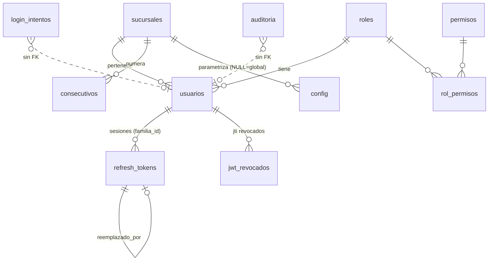
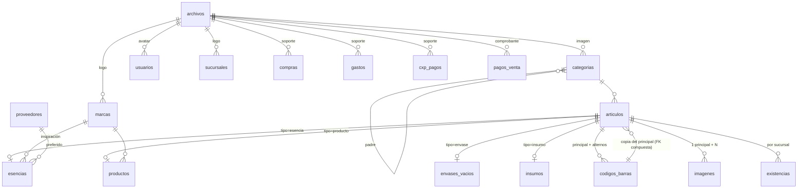
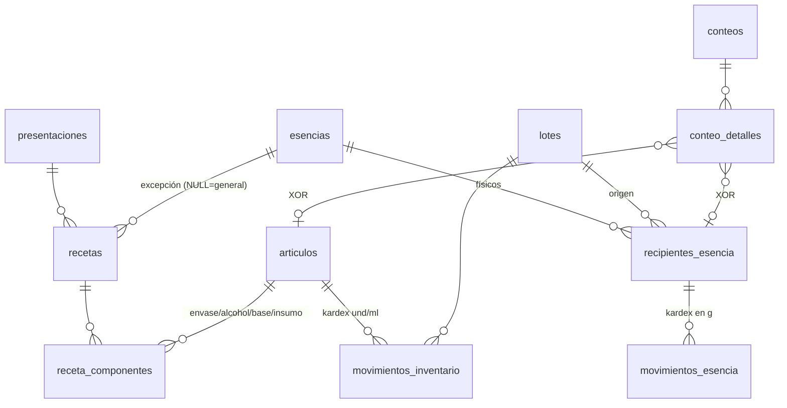
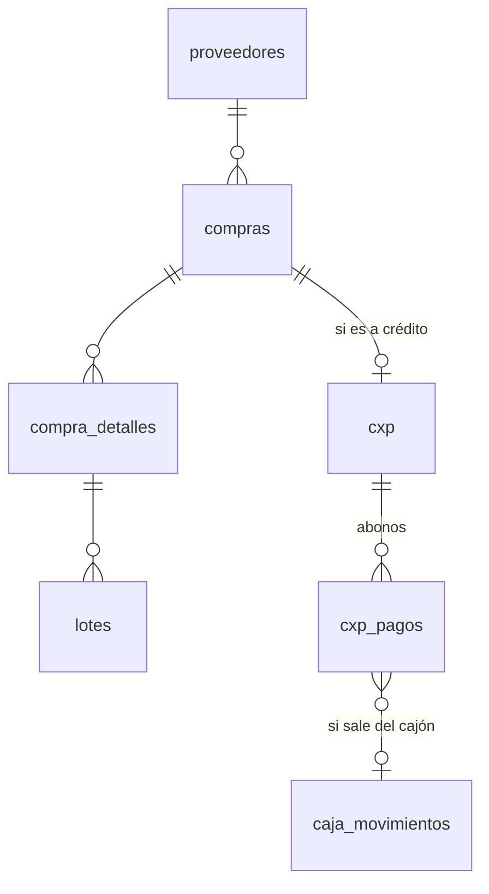
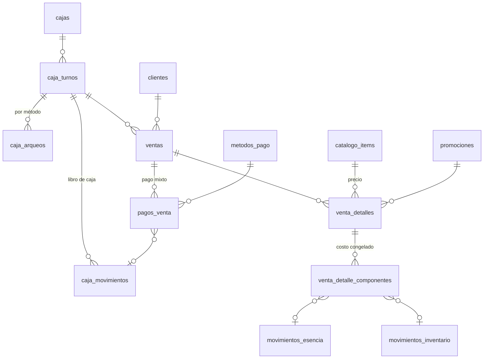
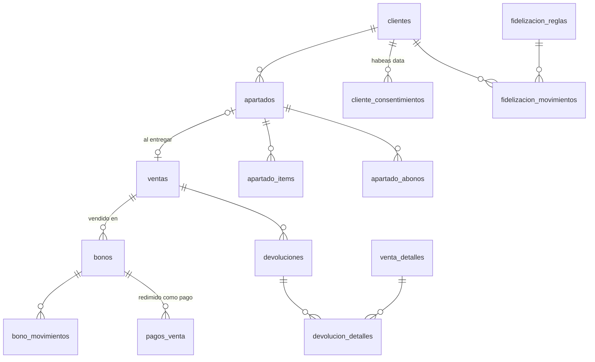

# Base de datos: perfumería

Archivos (se aplican en este orden):
- `database/migrations/0001_schema.sql`: esquema base (62 tablas, 9 vistas, 14 triggers de solo inserción).
- `database/migrations/0002_integridad_y_archivos.sql`: tabla `archivos`, rutas de imagen estrictas, FKs compuestas de coherencia, CHECK de signo en `movimientos_inventario`, cupo de promociones, 2 vistas de control (ver §10).
- `database/seeds/0001_seed_base.sql`: roles, permisos, métodos de pago, consecutivos, sucursal, caja, presentaciones y configuración. No trae usuarios: el admin inicial se crea con `php scripts/crear_admin.php` (script pendiente; ver SEGURIDAD_AUTH.md).
- `database/seeds/0002_seed_archivos.sql`: parámetros de subida (miniatura, megapíxeles, calidad WebP, tamaño de PDF).
- `database/scripts/usuarios_bd.sql`: cuentas de BD de mínimo privilegio, sin contraseñas (ver §11).

**Total tras 0002:** 63 tablas, 11 vistas, 179 FKs, 97 CHECK, 14 triggers. Verificado el 2026-11-23 en MariaDB 10.4.32 (XAMPP) sobre la base `perfumeria_test`, con `sql_mode` `STRICT_ALL_TABLES,NO_ZERO_DATE,NO_ZERO_IN_DATE,ERROR_FOR_DIVISION_BY_ZERO`: migraciones y seeds (estos dos veces, para comprobar que se pueden re-ejecutar) sin errores ni advertencias, todas las vistas se ejecutan, 18 casos inválidos son rechazados por CHECK/UNIQUE/FK/trigger. Se buscó compatibilidad con MySQL 8.0.19+, pero no se ha probado allí.

## 1. Convenciones

| Tema | Decisión |
|---|---|
| Motor / juego de caracteres | InnoDB, `utf8mb4_unicode_ci`. Códigos (sku, barras, hashes, slugs) en `ascii` (`ascii_bin` si distingue mayúsculas): índices hasta 4 veces más pequeños |
| Dinero | `DECIMAL(14,2)` |
| Gramos | `DECIMAL(10,3)` (recipientes y movimientos de esencia) |
| Cantidades de artículos | `DECIMAL(12,3)` (unidades o ml; en `existencias` también los gramos totales) |
| Costo unitario / por gramo | `DECIMAL(14,6)` |
| IDs | `TINYINT`/`SMALLINT UNSIGNED` (roles, métodos, sucursales, presentaciones), `INT UNSIGNED` (maestros, documentos), `BIGINT UNSIGNED` (ventas, detalles, movimientos, auditoría, tokens) |
| Fechas | `DATETIME` en hora de Colombia (la app ejecuta `SET time_zone='-05:00'`); sin `TIMESTAMP` (desborda en 2038) |
| IPs | `VARBINARY(16)` con `INET6_ATON()`/`INET6_NTOA()` |
| Borrado | Lógico (`eliminado_en`, `activo`, `anulada_en`). Nunca `DELETE` sobre maestros con historia |
| "Uno solo activo" | Columna generada `IF(cond,1,NULL) STORED` + `UNIQUE` (NULL no colisiona): una sola imagen principal, un solo código principal, un solo turno abierto por caja y por usuario |
| Archivos | Nunca BLOB ni base64: el binario va a disco (`storage/uploads`) y la BD guarda la ruta relativa + metadatos (ver §9) |
| sql_mode | **La app debe fijar en cada conexión** `STRICT_ALL_TABLES,STRICT_TRANS_TABLES,ERROR_FOR_DIVISION_BY_ZERO,NO_ZERO_DATE,NO_ZERO_IN_DATE,NO_ENGINE_SUBSTITUTION` y `SET NAMES utf8mb4 COLLATE utf8mb4_unicode_ci` (el servidor de XAMPP usa `utf8mb4_general_ci` por defecto). El `my.ini` de XAMPP trae un modo no estricto que **trunca en silencio** (comprobado: un PAN de 16 dígitos se guardó como `4111` en `ultimos4`). También conviene ponerlo en `my.ini` |

## 2. Diagramas ER por módulo (Mermaid)

### 2.1 Núcleo y seguridad


### 2.2 Maestro de artículos, imágenes y códigos


### 2.3 Esencias, recetas e inventario


### 2.4 Compras y cuentas por pagar


### 2.5 Caja, ventas y pagos


### 2.6 Pasivos, devoluciones y fidelización


## 3. Diccionario resumido

| Módulo | Tabla | Propósito / reglas clave |
|---|---|---|
| Control | `migraciones` | Archivos aplicados con checksum |
| Núcleo | `sucursales` | Existe desde el día 1; todo documento lleva `sucursal_id` |
| | `config` | Parámetros por clave (`ambito` 0 = global). Nunca secretos |
| | `consecutivos` | Numeración sin huecos por sucursal y tipo; `FOR UPDATE` dentro de la transacción del documento |
| Seguridad | `roles`, `permisos`, `rol_permisos` | RBAC: el rol va en el JWT; los permisos se resuelven en el servidor |
| | `usuarios` | `password_hash`, `pin_hash`, `token_version`, bloqueo, borrado lógico |
| | `refresh_tokens` | Hash SHA-256 del token opaco, `familia_id`, rotación (`reemplazado_por`), tope absoluto `sesion_expira_en` |
| | `jwt_revocados` | Lista de revocación por `jti`, se purga cuando pasa `expira_en` |
| | `login_intentos`, `limites_tasa` | Bloqueo y rate limit sin Redis |
| | `auditoria` | Solo inserción; antes/después en JSON; sin FKs a propósito |
| Artículos | `articulos` | Supertipo: `tipo`, `sku` UNIQUE, `codigo_barras` UNIQUE (principal), IVA, stock mínimo, FULLTEXT por nombre |
| | `codigos_barras` | Todos los códigos (principal y alternos) con unicidad global; EAN-13/EAN-8/UPC-A validados por CHECK; `unidades` para empaques |
| | `imagenes` | N fotos por artículo (`orden`, `es_principal`, `alt_texto`); una principal vigente; ruta aleatoria validada por CHECK (§9); misma foto (hash) no se repite entre las vigentes |
| Archivos | `archivos` | Imágenes sueltas y comprobantes (logo de marca/sucursal, imagen de categoría, avatar, soportes de compras, gastos, pagos a proveedor y pagos de venta). Solo ruta + metadatos |
| | `esencias`, `productos`, `envases_vacios`, `insumos` | Subtipos 1:1 con `articulos` |
| | `categorias`, `marcas` | Jerarquía y casas |
| Inventario | `existencias` | Saldo vigente por sucursal y artículo, `cantidad_reservada` (apartados), costo promedio ponderado. CHECK `>= 0` |
| | `recipientes_esencia` | Frasco o garrafa física con etiqueta `codigo`, tara y gramos actuales (CHECK `>= 0` y `<= capacidad`) |
| | `movimientos_esencia` | Kardex en gramos por recipiente; CHECK de signo por tipo; `operacion_id` agrupa salida, entrada y merma de un trasvase |
| | `movimientos_inventario` | Kardex en unidades o ml de productos, envases e insumos |
| | `lotes` | Trazabilidad y vencimiento (el costeo no es por lote) |
| | `conteos`, `conteo_detalles` | Conteo físico; cada detalle es un artículo o un recipiente (XOR); la diferencia se aplica como movimiento |
| Recetas | `presentaciones` | 30/50/60/100/120 ml con precio base |
| | `recetas`, `receta_componentes` | Receta general por presentación o excepción por esencia; tipo `refill` sin envase. Componente `esencia` con `articulo_id` NULL = "la esencia vendida" |
| Compras | `proveedores`, `compras`, `compra_detalles` | UNIQUE (proveedor, factura) evita registrar dos veces la misma factura; CHECK `total = subtotal - descuento + iva` |
| | `cxp`, `cxp_pagos` | Saldo `0 <= saldo <= original` |
| Caja | `metodos_pago` | EFECTIVO, NEQUI, DAVIPLATA, tarjetas, transferencia y los pasivos BONO, PUNTOS y APARTADO |
| | `cajas`, `caja_turnos`, `caja_arqueos` | Un turno abierto por caja y por usuario; arqueo ciego por método |
| | `caja_movimientos` | Libro de caja de solo inserción con CHECK de signo por tipo |
| Ventas | `ventas` | `idempotency_key` UNIQUE (evita duplicar por doble clic); CHECK `total = subtotal + iva_total`; `costo_total` congelado |
| | `venta_detalles` | Línea con precio, descuento, base, IVA y costo congelados; CHECK de coherencia por tipo |
| | `venta_detalle_componentes` | Componente real consumido (recipiente concreto) con costo unitario congelado |
| | `pagos_venta` | Pago mixto; tarjeta solo `ultimos4` (CHECK 4 dígitos) |
| | `catalogo_items`, `promociones` | Lista de precios y catálogo público (sin costos) |
| Pasivos | `bonos`, `bono_movimientos` | Código guardado como hash SHA-256 (es un título al portador); saldo entre 0 y el valor inicial |
| | `apartados`, `apartado_items`, `apartado_abonos` | El abono es un anticipo (pasivo); la venta se crea al entregar |
| Devoluciones | `devoluciones`, `devolucion_detalles` | Revierten al costo congelado original; `reintegra_stock = 0` se registra como merma |
| Clientes | `clientes`, `cliente_consentimientos` | Finalidades separadas (tratamiento y marketing), versión del texto, historial de solo inserción, anonimización |
| Fidelización | `fidelizacion_reglas`, `fidelizacion_movimientos` | Puntos o sellos; caché de saldo en `clientes` |
| Finanzas | `categorias_gasto`, `gastos`, `cierres_mensuales` | `periodo` AAAAMM generado; CHECK `utilidad = ventas - cogs - gastos` |

Vistas: `v_catalogo_publico` (sin costos ni stock exacto; desde 0002 también `imagen_id`, `imagen_miniatura`, `imagen_alt`), `v_stock_actual` (con `bajo_minimo`), `v_ventas_diarias`, `v_devoluciones_mensuales`, `v_utilidad_mensual`, `v_caja_turno_resumen`, `v_kardex`, `v_cxp_pendientes`, `v_pasivos`, y de control (0002): `v_control_articulos` (artículos sin código principal, con copia desincronizada o sin foto principal) y `v_control_existencias_esencia` (gramos en `existencias` frente a la suma de recipientes).

## 4. Decisiones de diseño (y alternativas descartadas)

1. **Supertipo `articulos`.** Imágenes y códigos de barras necesitan una FK real hacia "cualquier ítem". Descartado: columnas polimórficas `(entidad_tipo, entidad_id)`, porque no admiten FK y dejan huérfanos.
2. **Códigos en una sola tabla con UNIQUE global.** El POS busca con `WHERE codigo = ?` sobre `uq_cb_codigo`, una sola búsqueda por índice. `articulos.codigo_barras` es una copia del principal (para listados y etiquetas) que el servicio escribe en la misma transacción. Descartado: código principal y alternos en tablas separadas, porque no se puede garantizar unicidad entre ambas sin triggers complejos.
3. **Esencias: saldo total en `existencias` y reparto en `recipientes_esencia`.** El costo promedio ponderado es por esencia y sucursal, no por recipiente. El trasvase solo mueve gramos entre recipientes (más la merma) y no cambia el costo/g.
4. **Dos kardex** (`movimientos_esencia` en gramos por recipiente y `movimientos_inventario` en unidades o ml), unificados en la vista `v_kardex`. Descartado: un solo libro con `recipiente_id` opcional, que mezcla unidades y debilita los CHECK de signo.
5. **Costo congelado en dos niveles:** `venta_detalles.costo_total` (para reportes rápidos) y `venta_detalle_componentes` (detalle y base de devoluciones). Editar recetas o costos nunca cambia el pasado.
6. **`recetas` como tabla intermedia** entre presentación y componentes: permite una receta general, excepciones por esencia y refill sin envase.
7. **Bonos con hash del código.** Si se filtra la BD, los códigos no se pueden usar. El POS calcula `SHA-256(código escaneado)` y busca por `uq_bonos_codigo`.
8. **Auditoría sin FKs.** Así nunca bloquea operaciones y puede archivarse o particionarse más adelante.
9. **Triggers de solo inserción** (una sentencia `SIGNAL`, sin `DELIMITER`) como defensa en profundidad, además de quitar `UPDATE`/`DELETE` al usuario de BD de la app.
10. **Sin particionado.** Volumen estimado de una tienda: unas 200 ventas/día, es decir ~75 mil ventas, ~150 mil líneas y ~500 mil componentes al año. InnoDB con buenos índices lo maneja sin problema durante años. Además, InnoDB no admite FKs en tablas particionadas. Plan de archivo cuando haga falta: `auditoria` y `login_intentos` por año a tablas `*_archivo` (con el trigger desactivado y documentado), purga diaria de `jwt_revocados` y `refresh_tokens` expirados y de `limites_tasa` antiguos.

## 5. Índices clave por consulta

| Consulta | Índice |
|---|---|
| Escaneo en POS | `codigos_barras.uq_cb_codigo` (igualdad exacta, ascii_bin) |
| Escaneo de recipiente (trasvase/conteo) | `recipientes_esencia.uq_recipientes_codigo` |
| Búsqueda por nombre en POS | `articulos.ix_articulos_tipo_activo_nombre` (prefijo `LIKE 'abc%'`) y `ft_articulos_nombre` (FULLTEXT) |
| Precio del ítem | `catalogo_items.uq_cat_item` (sucursal + clave única) |
| Stock al vender | PK `existencias (sucursal_id, articulo_id)`; recipientes por `ix_recipientes_esencia (esencia_id, sucursal_id, estado)` |
| Receta | `recetas.uq_recetas (presentacion_id, esencia_clave, tipo)`: se busca la excepción (esencia_id) y, si no existe, la general (0) |
| Numeración | `consecutivos.uq_consecutivos_suc_tipo` |
| Turno abierto | `caja_turnos.uq_turno_usuario_abierto` / `uq_turno_caja_abierta` |
| Arqueo de turno | `caja_movimientos.ix_cm_turno_metodo (turno_id, metodo_pago_id)` |
| Ventas del día / reportes | `ventas.ix_ventas_suc_fecha (sucursal_id, fecha, estado)`; detalle por `uq_vd_linea` |
| Ventas por cliente / vendedor | `ix_ventas_cliente_fecha`, `ix_ventas_usuario_fecha` |
| Kardex de un artículo | `ix_mi_articulo_fecha`, `ix_me_recipiente (recipiente_id, id)`, `ix_me_esencia_fecha` |
| Doble venta por reintento | `ventas.uq_ventas_idempotencia` |
| Gastos del mes | `gastos.ix_gastos_suc_periodo (sucursal_id, periodo, anulado_en)` |
| CxP vencidas | `cxp.ix_cxp_estado_venc (estado, fecha_vencimiento)` |
| Refresh token | `refresh_tokens.uq_rt_token_hash` (búsqueda por hash, nunca por token en claro) |
| Revocación por jti | PK `jwt_revocados (jti)` |
| Rate limit de login | `login_intentos.ix_li_ip_fecha`, `ix_li_usuario_fecha` |

Todas las FKs tienen índice (InnoDB lo exige; donde la FK es prefijo de un índice compuesto se reutiliza ese índice).

## 6. Concurrencia y bloqueos

**Regla:** toda operación que toque stock, caja, saldo de bono o puntos se hace en una transacción de `VentaService`, `StockService`, `CajaService`, etc., con `SELECT ... FOR UPDATE` y **siempre en el mismo orden global** para evitar deadlocks:

1. `consecutivos` (la fila del tipo de documento)
2. `caja_turnos` (el turno, para confirmar que sigue abierto)
3. `existencias` ordenadas por `articulo_id` ascendente (se bloquean todas las filas de la venta en una sola consulta: `WHERE sucursal_id=? AND articulo_id IN (...) ORDER BY articulo_id FOR UPDATE`)
4. `recipientes_esencia` ordenados por `id` ascendente
5. `lotes` por `id`
6. `bonos` por `id`; `apartados` por `id`
7. `clientes` (saldo de puntos)
8. `cxp` por `id`

Notas:
- Validar `cantidad - cantidad_reservada >= requerida` **después** del `FOR UPDATE`, no antes. El CHECK `>= 0` es la última red: si salta, se hace rollback y se informa "stock insuficiente".
- El consecutivo bloqueado serializa las ventas de una sucursal durante unos milisegundos. Es aceptable para una tienda y evita huecos en la numeración (requisito previo a la DIAN). Si en algún momento estorba, se puede tomar el número al final de la transacción, justo antes del COMMIT.
- Mantener las transacciones cortas: calcular precios y validar la entrada **antes** de `BEGIN`; dentro solo bloquear, verificar, insertar y actualizar.
- Nivel de aislamiento: el `REPEATABLE READ` por defecto funciona. Se recomienda `READ COMMITTED` en la sesión del POS para reducir los bloqueos de rango (gap locks) en inserciones de libros; los `FOR UPDATE` sobre PK no cambian.
- Reintento automático (máx. 3) ante el error 1213 (deadlock) o 1205 (lock wait timeout) en el servicio.
- Idempotencia: el formulario del POS genera un UUID; un reintento devuelve la venta ya creada (`uq_ventas_idempotencia`).

## 7. Identificadores, códigos de barras, etiquetas y lector USB

**Identificadores de cada ítem**
- `articulos.sku` (obligatorio, único): `ESE-000123`, `PRD-`, `ENV-`, `INS-`, con la secuencia del consecutivo `SKU`.
- Código de fábrica (EAN-13/EAN-8/UPC-A) si el artículo lo trae: se valida el dígito de control en PHP (módulo 10 GS1) y la longitud por CHECK. Un UPC-A de 12 dígitos se **normaliza** a EAN-13 anteponiendo `0`, porque muchos lectores envían 13 dígitos.
- Sin código de fábrica: se **genera un EAN-13 interno** `200` + 9 dígitos del consecutivo `CODIGO_INTERNO` + dígito de control. El prefijo 20–29 de GS1 está reservado para circulación restringida o uso dentro de la tienda, así que no choca con productos reales. Se marca `origen='interno'`.
- Code128 para etiquetas que no son de venta: recipientes de esencia (`recipientes_esencia.codigo`, p. ej. `R-000045`), bonos y ubicaciones.
- Varios códigos por artículo (otro proveedor, caja de 6 con `unidades=6`): filas extra en `codigos_barras`. Uno solo es `es_principal` y se copia a `articulos.codigo_barras`.

**Etiquetas imprimibles sin dependencias pesadas**
- Generar el código como **SVG en PHP puro**. EAN-13 son ~60 líneas (tablas L/G/R y patrón de paridad) y Code128-B ~120 (tabla de 107 patrones + checksum módulo 103). Opcionalmente se puede usar `picqer/php-barcode-generator` (MIT, sin dependencias) en vez de escribirlo. SVG escala sin pixelarse en impresoras térmicas de 203 dpi.
- Plantilla HTML de etiquetas con `@page { size: 50mm 25mm; margin: 0 }` (o una hoja A4 con rejilla) y `@media print`. Contenido: nombre corto, precio, SKU, SVG del código con el texto legible debajo. Se imprime con el diálogo del navegador en la impresora de etiquetas o en la térmica de 58/80 mm.
- Las etiquetas no exponen costos (la plantilla no recibe esos campos).

**Lectura en el POS con lector USB (modo teclado HID)**
- El lector "teclea" el código y envía `Enter`. El campo de búsqueda del POS tiene `autofocus`, vuelve a tomar el foco tras cada acción y está dentro de un `<form>` que hace `hx-post="/pos/escanear"`.
- Para distinguir el lector de una persona: si los caracteres llegan con menos de ~30 ms entre sí y terminan en `Enter`, es un escaneo (se agrega el ítem directo). Si no, se trata como búsqueda por nombre. Configurar el lector con sufijo `Enter` y sin prefijo.
- En el servidor: `trim`, normalizar UPC-A a EAN-13, `SELECT ... FROM codigos_barras WHERE codigo = ?` (índice único). Si es un recipiente o un bono, se busca en su tabla (los bonos por `SHA-256` del código).
- Una esencia escaneada abre la selección de presentación (30/50/60/100/120 ml) y se resuelve la receta. Si el código no existe: aviso visual y sonoro, sin agregar nada. Un permiso permite asignar el código al vuelo.
- No hay que capturar teclas globales en todo el documento: solo el campo del POS. Así se evita "escribir" en otros formularios.

## 8. Notas de rendimiento

- Paginación por clave (`WHERE id < ? ORDER BY id DESC LIMIT 50`) en kardex, auditoría y ventas; evitar `OFFSET` grandes.
- Reportes con rango de fechas sobre columnas indexadas (`fecha >= ? AND fecha < ?`), nunca `DATE(fecha) = ?` en el `WHERE`.
- Las vistas de reportes agregan sobre tablas base. Si con los años `v_utilidad_mensual` se vuelve lenta, se usa `cierres_mensuales` como resumen precalculado de los meses cerrados.
- `innodb_buffer_pool_size`: el valor de XAMPP es pequeño (16 MB en algunos `my.ini`); subirlo a 256–512 MB en el equipo de la tienda.
- Activar `slow_query_log` con `long_query_time=0.5` durante el Sprint 11.
- Imágenes: en la BD solo se guarda la ruta y los metadatos (nunca BLOBs). Ver §9.

## 9. Archivos subidos: convención de rutas

**Regla:** ninguna tabla guarda binarios (no hay columnas BLOB, base64 ni `LONGTEXT` con imágenes; comprobado en `information_schema`). El archivo se escribe en disco y la BD guarda su **ruta relativa** y sus metadatos.

**Raíz:** `storage/uploads/` (variable `UPLOADS_DIR` en `.env`), **fuera de `public/`**. `storage/.htaccess` y `storage/uploads/.htaccess` niegan todo acceso web y desactivan PHP como segunda barrera. Las imágenes se sirven solo con `GET /media/{id}/{grande|mini}` (SEGURIDAD_AUTH.md §5), que valida permisos y toma el `Content-Type` de la BD. Si en un hosting se copian las publicadas a `public/media/`, esa carpeta lleva el `.htaccess` de SEGURIDAD_AUTH.md §5.

**Qué tablas guardan rutas**

| Tabla / columna | Contenido | Directorio |
|---|---|---|
| `imagenes.ruta`, `imagenes.ruta_miniatura` | Galería de cada artículo (esencias, productos, envases, insumos): `orden`, `es_principal` (una sola vigente), `alt_texto` | `articulos/` |
| `archivos.ruta`, `archivos.ruta_miniatura` | Una imagen o documento suelto, referenciado por id desde: | según `archivos.categoria` |
| ↳ `marcas.logo_archivo_id` | Logo de la casa | `marcas/` |
| ↳ `categorias.imagen_archivo_id` | Imagen de la categoría (catálogo) | `categorias/` |
| ↳ `usuarios.avatar_archivo_id` | Foto del usuario | `usuarios/` |
| ↳ `sucursales.logo_archivo_id` | Logo del ticket y del catálogo | `sucursales/` |
| ↳ `compras.soporte_archivo_id`, `gastos.soporte_archivo_id`, `cxp_pagos.soporte_archivo_id`, `pagos_venta.comprobante_archivo_id` | Factura del proveedor, soporte de gasto, comprobante de pago o captura de Nequi/Daviplata (imagen o **PDF**) | `comprobantes/` |

`gastos.soporte_ruta` (de 0001) se eliminó en 0002 y se reemplazó por `gastos.soporte_archivo_id`.

**Formato de la ruta (impuesto por CHECK)**
```
<directorio>/<ab>/<cd>/<abcd + 28 hex>.<ext>          ej. articulos/3f/a9/3fa9c2e17b604d8e9a5f0c3b2d1e4f60.webp
<directorio>/<ab>/<cd>/<abcd + 28 hex>_mini.<ext>     miniatura (mismo nombre base)
```
- Nombre = `bin2hex(random_bytes(16))` (32 hex en minúsculas). `<ab>/<cd>` son los 4 primeros caracteres del nombre, para no llenar un solo directorio. El CHECK comprueba que coincidan.
- **Nunca** se usa el nombre original ni ningún dato del usuario en la ruta. `archivos.nombre_original` es solo un metadato (para el nombre de descarga de un comprobante); se escapa al mostrarlo y se envía con `Content-Disposition` usando `rawurlencode`.
- Sin `..`, sin mayúsculas, sin espacios, sin barra inicial (ruta relativa). Columna `VARCHAR(120) ascii_bin` (distingue mayúsculas).
- Extensión coherente con el `mime` (CHECK `ck_img_ext_mime` / `ck_arch_ext_mime`); el MIME se detecta con `finfo`, no se toma del navegador.
- `archivos.categoria` debe coincidir con el primer directorio (CHECK `ck_arch_categoria`). Los PDF solo se admiten en `comprobantes` y no tienen miniatura ni dimensiones.

**Formatos y tamaños**

| Tipo | MIME admitidos | Tamaño máximo (CHECK) | Procesado |
|---|---|---|---|
| Imágenes (artículos, logos, categorías, avatares, capturas) | `image/webp` (preferido), `image/jpeg`, `image/png` | 5 MB (`imagen_max_bytes`) | Re-codificada con GD a WebP calidad 82, lado mayor 1600 px y miniatura de 320 px; se eliminan EXIF/GPS; rechazo si supera 40 MP antes de decodificar |
| Comprobantes | los anteriores + `application/pdf` | 10 MB (`comprobante_max_bytes`) | Las imágenes igual que arriba; el PDF se guarda tal cual (validar `%PDF-` y `finfo`) y se sirve con `Content-Disposition: attachment` |

**Ciclo de vida**
1. Subida: validar → re-codificar → calcular SHA-256 → escribir en un archivo temporal dentro de `storage/uploads` → `rename()` al destino → `INSERT` de la fila. Si el `INSERT` falla, borrar el archivo. (El disco no participa de la transacción: mejor un archivo huérfano que una fila sin archivo.)
2. Duplicados: `imagenes` rechaza la misma foto (hash) dos veces en un artículo entre las vigentes; `archivos.hash_sha256` está indexado para reutilizar si se quiere.
3. Borrado: lógico (`eliminado_en`). Un job periódico elimina del disco los archivos con `eliminado_en` antiguo **y** sin referencias (las FKs son RESTRICT, así que una fila de `archivos` referenciada no se puede borrar).
4. Respaldo: `storage/uploads/` se copia junto con el `mysqldump` (las rutas de la BD no sirven sin los archivos).

## 10. Auditoría del esquema (2026-11-23) y migración 0002

**Lo que ya estaba bien (se mantiene):** 3FN en general, con cachés de saldo deliberadas y documentadas (`existencias`, `clientes.puntos_saldo`, `apartados.abonado`, `articulos.codigo_barras`); InnoDB y `utf8mb4_unicode_ci` en todas las tablas, códigos en `ascii`; dinero en `DECIMAL`, sin `FLOAT`/`DOUBLE` ni `TIMESTAMP`; UNIQUE en SKU, código de barras (global), email de usuario, usuario, NIT, factura de proveedor, idempotencia de venta; todas las FKs con índice; FKs `RESTRICT` (borrado lógico) salvo `rol_permisos` y `receta_componentes` (`CASCADE`, tablas puente); stock sin carreras: `existencias` con PK (sucursal, artículo) para `FOR UPDATE`, CHECK `cantidad >= 0` y `reservada <= cantidad`, saldos de recipientes, lotes, bonos, CxP y apartados acotados por CHECK, libros de solo inserción con triggers; imágenes ya por ruta, nunca BLOB.

**Cambios de 0002 y por qué**

| # | Cambio | Motivo |
|---|---|---|
| A | `refresh_tokens.reemplazado_por` → `ON DELETE SET NULL` | Con `RESTRICT`, la purga de una familia en un solo `DELETE` puede fallar: InnoDB comprueba la FK auto-referenciada fila a fila |
| B | Tabla `archivos` + `*_archivo_id` en marcas, categorías, usuarios, sucursales, compras, gastos, pagos a proveedor y pagos de venta; se quita `gastos.soporte_ruta` | Faltaban imágenes/soportes fuera de artículos; un solo lugar con metadatos y CHECK de ruta en vez de columnas sueltas |
| C | `imagenes`: CHECK de ruta estricto (directorio, reparto coherente, 32 hex), miniatura con el mismo nombre, extensión = MIME, dimensiones > 0, hash único solo entre vigentes | El CHECK de 0001 (`^[a-z0-9/]+\.(webp\|jpg\|png)$`) aceptaba rutas arbitrarias; una foto borrada impedía volver a subirla |
| D | FK compuesta `articulos (id, codigo_barras)` → `codigos_barras (articulo_id, codigo)` | La copia del código principal podía apuntar a un código inexistente o de otro artículo |
| E | FK `movimientos_esencia (recipiente, esencia, sucursal)` → `recipientes_esencia`; el código de un recipiente no puede ser solo dígitos | Dependencia transitiva sin garantía; un código numérico podía confundirse con un EAN en el lector |
| F | FK `movimientos_inventario (articulo, sucursal)` → `existencias`; lote coherente; CHECK de signo por tipo | No puede haber kardex sin la fila de saldo que se bloquea con `FOR UPDATE`; una "venta" positiva era aceptada |
| G | FKs compuestas turno↔caja, movimiento de caja↔turno, venta↔turno y devolución↔turno con la misma sucursal | `sucursal_id` duplicado sin garantía (preparación para multi-sucursal) |
| H | CHECK `usos_actuales <= usos_max` en `promociones` | Dos cajas canjeando el último cupo de un cupón a la vez: la segunda falla en vez de sobrepasarlo |
| I | `v_catalogo_publico` + `imagen_id`/miniatura/alt; vistas `v_control_*` | `/media/{id}` necesita el id; detectar artículos sin código o sin foto y descuadres de gramos |

**Descartado:** guardar imágenes en BLOB (respaldos enormes, buffer pool desperdiciado); una tabla polimórfica `(entidad, entidad_id)` para todos los archivos (no admite FK); mover la galería de artículos a `archivos` (rompería 0001 y añade un join en el POS); `UNSIGNED` en columnas `DECIMAL` (obsoleto en MySQL 8.0.17; se usan CHECK); FK con `ON UPDATE CASCADE` para el código principal (en una FK compuesta con `articulos.id` arrastraría cambios de PK).

**Notas para los servicios:**
- Alta de artículo: `INSERT articulos` (con `codigo_barras` NULL) → `INSERT codigos_barras` (`es_principal=1`) → `UPDATE articulos SET codigo_barras` → `INSERT existencias` por sucursal, todo en una transacción. Crear la fila de `existencias` al dar de alta el artículo evita la carrera de dos compras simultáneas creando la primera fila (si no, usar `INSERT ... ON DUPLICATE KEY UPDATE cantidad = cantidad` y después `SELECT ... FOR UPDATE`).
- Cambiar el código principal: quitar `es_principal` al anterior, ponerlo al nuevo y actualizar la copia, en la misma transacción. Para borrar un código, primero se cambia la copia.
- `movimientos_inventario`: `reserva` (+) y `liberacion_reserva` (−) son el delta de `cantidad_reservada`; `saldo_despues` no cambia en esos tipos.
- Prueba de concurrencia hecha: con una sesión bloqueando la fila de `existencias` con `FOR UPDATE`, una segunda sesión espera y recibe el error 1205 (lock wait timeout); el servicio debe reintentar (máx. 3) ante 1205/1213.

**Pendiente de decisión:** el pedido inicial mencionaba `DECIMAL(10,2)` para dinero; el esquema usa `DECIMAL(14,2)` (máx. 999.999.999.999,99). Se mantiene porque en pesos colombianos `DECIMAL(10,2)` tope en ~100 millones, poco para cierres mensuales, valor de inventario o compras grandes, y ampliar después obliga a alterar decenas de columnas.

## 11. Aplicar el esquema y usuarios de BD

```bash
# BD nueva (el runner scripts/migrate.php hará esto y registrará cada archivo en `migraciones` con su SHA-256)
mysql -u root -e "CREATE DATABASE perfumeria CHARACTER SET utf8mb4 COLLATE utf8mb4_unicode_ci"
M="mysql -u root --default-character-set=utf8mb4 --init-command=\"SET SESSION sql_mode='STRICT_ALL_TABLES,NO_ZERO_DATE,NO_ZERO_IN_DATE,ERROR_FOR_DIVISION_BY_ZERO,NO_ENGINE_SUBSTITUTION'\" perfumeria"
$M < database/migrations/0001_schema.sql
$M < database/migrations/0002_integridad_y_archivos.sql
$M < database/seeds/0001_seed_base.sql
$M < database/seeds/0002_seed_archivos.sql
```
Usuarios de mínimo privilegio: `database/scripts/usuarios_bd.sql`. Por defecto solo lista los `CREATE USER`/`GRANT` que haría; con `--init-command="SET @ejecutar=1"` los aplica. Crea `perf_app`, `perf_catalogo` y `perf_backup` **bloqueados y sin contraseña**; la contraseña se pone a mano en el cliente interactivo (`ALTER USER ... IDENTIFIED BY ... ACCOUNT UNLOCK`) y se guarda solo en `.env`. Re-ejecutarlo tras cada migración que cree tablas. Las vistas usan `SQL SECURITY DEFINER` con el usuario que ejecutó la migración: no borrar esa cuenta. Si la app conecta por `127.0.0.1` (TCP) y el servidor tiene `skip-name-resolve`, crear también las cuentas `@'127.0.0.1'`.

## 12. Implementación Sprint 1B: catálogo de inventario (diferencias y decisiones)

Código: `src/Services/{ArticuloService,RecipienteService,CatalogosService,InventarioService,SkuService}.php`, `src/Support/{Decimal,Entrada}.php`, controladores `ArticulosController`, `RecipientesController`, `CatalogosController`. Sin cambios de esquema (no hay migración 0003).

| Tema | Diseño original | Implementado | Motivo |
|---|---|---|---|
| SKU autogenerado | `ESE-000123`, `PRD-`... con "la secuencia del consecutivo SKU" | Una sola secuencia compartida por todos los tipos (fila `consecutivos` tipo `SKU` de la sucursal de menor id) con prefijo por tipo; bloqueo `SELECT ... FOR UPDATE` en la misma transacción del alta; si el SKU siguiente ya existe (tecleado a mano) se salta | El ENUM `consecutivos.tipo` solo tiene un valor `SKU`; una secuencia por tipo de artículo exigiría migración. Los SKU son únicos en todo el sistema, por eso no se usa el consecutivo de la sucursal del usuario. Cada prefijo ve saltos (ESE-1, PRD-2, ESE-3); la secuencia global no tiene huecos |
| Saldo inicial | "alta con saldo inicial como movimiento" | Productos/envases/insumos: movimiento `saldo_inicial` en `movimientos_inventario` en la sucursal del actor. Esencias: solo al crear un recipiente (`movimientos_esencia`, gramos) | En esencias el saldo vive en recipientes (§3 decisión 3); un saldo sin recipiente rompería `v_control_existencias_esencia` |
| Costo del saldo inicial | — | `existencias.costo_promedio` = promedio ponderado calculado por MariaDB (`CAST ... AS DECIMAL`, sin float) y `ultimo_costo` = costo del asiento | El costo no vive en `articulos`; las columnas de costo solo se SELECCIONAN con `inventario.ver_costos` |
| Código de recipiente | `R-000045` | `R-` + id (se inserta con un código temporal y se renombra en la misma transacción). Los códigos manuales `R-<dígitos>` se rechazan | `consecutivos.tipo` no tiene valor para recipientes (requeriría migración) |
| Tipo, SKU y unidad | — | Inmutables si hay historia: filas en cualquier tabla con FK al artículo o a su esencia (lista `ArticuloService::REFERENCIAS_*`, vigilada por un test contra `information_schema`) o existencias ≠ 0 | Cambiar el tipo reasigna el subtipo y rompería recetas, ventas y kardex |
| Permisos | — | Lectura `articulos.ver` (existencias `inventario.ver`, costos `inventario.ver_costos`); escritura `articulos.gestionar`; saldo inicial además `inventario.ajustar` + `inventario.ver_costos`. Marcas y categorías usan los mismos | No se crean permisos nuevos |
| Borrado | lógico | `articulos.activo`, `marcas.activa`, `categorias.activa`, `recipientes_esencia.estado='baja'`. No se desactiva un artículo con `cantidad_reservada` > 0 ni se da de baja un recipiente con gramos | — |

Pendiente para otros sprints: crear las filas de `existencias` de los artículos existentes cuando se active una sucursal nueva (hoy `InventarioService::bloquearExistencia` las crea al primer uso), `proveedor_preferido_id` de la esencia (no hay CRUD de proveedores hasta el Sprint 4), y `marcas.logo_archivo_id` / `categorias.imagen_archivo_id` (1C).
